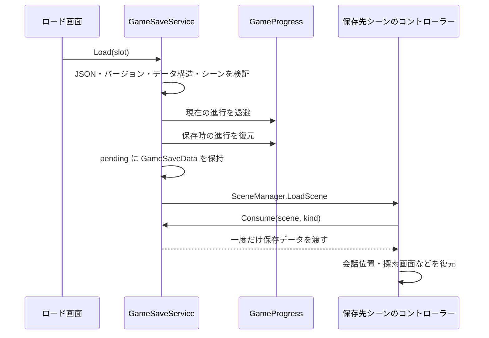

# セーブ・ロード

最終確認: 2026-10-28。

この資料は手動セーブの6枠、ロード処理、および好感度・獲得情報・探索取得状態の保存を扱います。シーンをまたぐ会話再開、プログレスのON/OFF、シーンごとの利用箇所と戻り先は [DialogueSceneProgress.md](DialogueSceneProgress.md) に統合しています。

## 1. 手動セーブ・ロード

### 1.1 操作と担当

- ゲーム中は `Esc` でメニューを開き、「セーブ」「ロード」から枠を選びます。
- タイトル画面の「ロード」からも同じスロットを読み込めます。
- 枠は画面上で `01`〜`06` の6個です。API の引数は `0`〜`5` です。
- 保存済みの枠への上書きと、ロード時には確認画面が出ます。
- スロットには保存日時、場面ラベル、会話本文または探索状況の要約が表示されます。スクリーンショット保存はありません。

主な担当は次のとおりです。

| ファイル | 役割 |
| --- | --- |
| [GameSaveService.cs](../Assets/Scripts/GameSaveService.cs) | 保存可否、スロット保存・検証・ロード、ロード先へのデータ受け渡し |
| [GameProgress.cs](../Assets/Scripts/GameProgress.cs) | 各機能の進行データをまとめて取得・復元・初期化 |
| [ArchiveMenuUI.SaveLoad.cs](../Assets/Scripts/Archive/ArchiveMenuUI.SaveLoad.cs) | セーブ・ロード画面、枠の表示、確認画面 |
| [ArchiveMenuUI.cs](../Assets/Scripts/Archive/ArchiveMenuUI.cs) | メニューからの入口、「最初から」 |
| [TitleMenu.cs](../Assets/Scripts/TitleMenu.cs) | タイトルからのロード、新規開始 |

### 1.2 保存形式

`GameSaveData` を `JsonUtility.ToJson()` で JSON にし、`PlayerPrefs.SetString()` と `PlayerPrefs.Save()` で保存します。専用のセーブファイルへ書き出す方式ではありません。

スロットキーは `GameSave.Slot.v1.0`〜`GameSave.Slot.v1.5`、データの `version` は `1` です。

| データ | 内容 |
| --- | --- |
| 共通 | バージョン、保存日時、シーン名、種類（`dialogue` / `search` / `selection`）、表示ラベル・要約 |
| 会話位置 | シナリオ名、現在の `lineId`、埋め込み会話の終了位置 `stopLineId` |
| 会話表示 | 全文表示済みか、公開済みの人物名、表示済みの相談行ID |
| 画像 | 背景・左立ち絵・右立ち絵の3件。Sprite名、Texture名、矩形、有効状態、位置、拡大率 |
| 進行 | アーカイブ、好感度、各探索の `PlayerPrefs` 値と、そのキーの有無 |
| 探索 | 部屋番号、部屋表示・調査表示・会話中の区別、対象アイテムID、紙が見えているか |
| 相手選択 | 導入文を閉じたかどうか |
| 個別結果 | カヨのゲージ成功フラグ `kayoGaugeSucceeded` |

画像そのものを JSON に埋め込むことはありません。復元時はロード済みの Sprite 群から名前・Texture名・矩形が一致するものを探します。

### 1.3 セーブできる場面

`GameSaveService` の `scenes` 配列で許可されたシーンのみが対象です。

| シーン | 保存する場面 |
| --- | --- |
| `NovelScene` | 共通ルートの会話 |
| `NovelScene_Kayo` | カヨの会話 |
| `NovelScene_Yowashi` | ヨワシの会話 |
| `Chapter1_SearchScene` | 共通探索 |
| `Chapter_Kayo_SearchScene` | カヨの探索 |
| `Chapter_Moteru_SearchScene` | モテルの探索 |
| `SelectionPart` | 話す相手の選択 |

**`NovelScene_Moteru` は Scene List に登録されていますが、この保存許可配列には含まれていません。現在の実装ではモテルの会話シーンで手動セーブできません。** `PuzzleGame`、各 `falling_ver*`、タイトルも保存対象外です。ミニゲームの途中経過・スコア・残り時間・パズルの配置はスロットに保存しません。

許可シーンでも、各コントローラーが安定した状態にある場合だけ保存できます。

- 会話: 再生中で現在行が存在し、章切り替え・シーン読み込み・スキップ確認・見回し演出の最中でないこと。
- 探索: 入場フェード・探索完了遷移の最中でないこと。探索中の会話は、内部の会話コントローラーも保存可能であること。
- 相手選択: 遷移中・確認表示のフェード中・確認画面表示中でないこと。

文字送り中の保存は可能です。ただし表示済みの文字数は保存せず、ロード後はそのセリフの文字送りを最初から行います。全文表示後に保存した場合は、ロード後も全文表示になります。

### 1.4 セーブの流れ

1. `GameSaveService.Save(slot, out message)` が現在のシーンとコントローラーから状態を取得する。
2. `GameProgress.CaptureCheckpoint()` が好感度を保存し、対象となる進行キーの値をまとめる。
3. 日時を付けて JSON に変換し、スロットへ保存する。
4. 保存処理で例外が起きた場合は、以前のスロット内容を戻す処理を試みる。

`CanSave()` も同じ取得処理で可否を調べます。自動でスロットを上書きする処理ではありません。

### 1.5 ロードの流れ

ロード前に会話プログレスの履歴・シーン別開始位置と公開済み人物名を初期化し、保存された人物名を復元します。進行データの復元後、シーンを `Single` で読み込みます。

`Consume(scene, kind)` はシーン名と種類が一致したときだけデータを返し、受け渡し後に `pending` を空にします。

- 通常の会話は `NovelDialogueController.Start()` でデータを受け取り、`RestoreCheckpoint()` を呼びます。
- 探索は各探索コントローラーの `Awake()` で受け取り、部屋・調査画面・内部会話を復元します。
- 相手選択は `SelectionPartController.Awake()` で導入文を閉じた状態を復元します。

会話の復元では、登録シナリオから「保存されたシナリオ名と `lineId`」の両方が一致する行を探します。AUTO は OFF に戻します。復元行の好感度変更とアーカイブ解除は `restoringCheckpointLine` で抑制し、ロードのたびに同じ効果が重なることを防ぎます。

不正なバージョン、必要なデータの欠落、対象外シーンなどは `Read()` の段階で拒否されます。`Load()` 内の例外時には進行データと人物名を戻す処理があります。ただし、シーン開始後にシナリオ・行・アイテムが見つからない場合は各コントローラーがエラーを出す実装であり、ロード前の画面まで戻す仕組みではありません。

## 2. 進行データの自動保存

次のキーは手動スロットとは別に更新されます。`GameProgress` はそれらをまとめる役割で、自ら一定間隔で保存する常駐コントローラーではありません。

| キー | 保存対象 | 主な更新契機・担当 |
| --- | --- | --- |
| `ArchiveState.v1` | 解除済みID、既読ID、実行中に獲得した情報 | `ArchiveManager` の解除・既読・情報獲得など。終了時にも保存 |
| `AffectionState` | キャラクター別の好感度 | `AffectionManager` の値変更時。`saveOnChange` の既定値は `true`、`loadOnAwake` も `true` |
| `Chapter1Search.Acquired.v1` | 共通探索の取得済みアイテムID | `Chapter1SearchController` の取得時 |
| `KayoSearch.Acquired.v1` | カヨ探索の取得済みアイテムID | `SearchSceneController` の取得時 |
| `MoteruSearch.Acquired.v1` | モテル探索の取得済みアイテムID | `SearchSceneController` と `SearchSceneProfileSO` の設定による取得時 |

`ArchiveManager` は自動生成されて `DontDestroyOnLoad` で常駐します。`AffectionManager` も存在するインスタンスを `DontDestroyOnLoad` で維持します。

手動保存時には上記5キーをスロット内にも取り込みます。ロード時はキーの有無まで保存時点へ戻し、好感度とアーカイブを再読み込みします。探索側はシーン初期化時に取得状態を読み込みます。したがって、古い枠をロードすると、その枠より後に獲得した情報や好感度も巻き戻ります。

以前の4キー構成のセーブも受け付けます。その場合はモテル探索のキーを削除してから復元し、現在の取得状態が混ざらないようにしています。

### 新規開始と Editor の違い

- タイトルの開始操作、およびメニューの「最初から」は `GameProgress.ResetAll()` を呼びます。会話プログレスの履歴・シーン別開始位置・公開名・パズルの戻りコンテキストと、上記の進行データを初期化します。
- `ResetAll()` は6個の手動スロットを削除しません。新規開始後も以前の枠をロードできます。
- **Unity Editor では Play Mode に入るたび、手動スロットと各進行キーを削除する初期化処理があります。** Play を止めて再度実行したときに枠が消えるのは、現在の開発用実装によるものです。製品実行時の保持動作とは区別してください。
