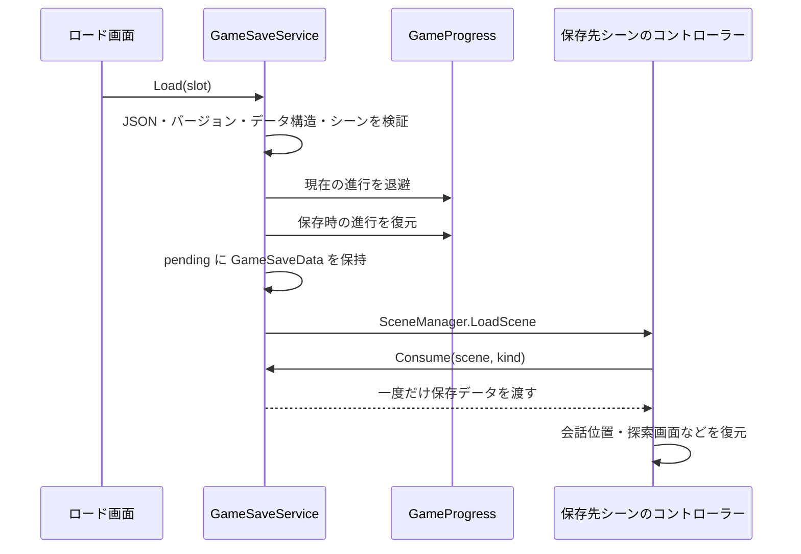
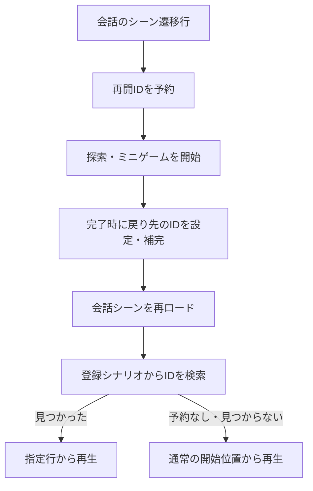

# セーブ・ロードとシーンをまたぐ会話再開

> 更新: シーンごとの会話プログレスを追加しました。新しい自動保存・復元、ON/OFF設定、再開要求の優先順位は [DialogueSceneProgress.md](DialogueSceneProgress.md) を参照してください。以下のシーン間再開に関する記述は、追加前の実装を整理したものです。手動セーブ枠とは独立して動作します。

確認日: 2026-10-23

対象: `takugen31/feat-progress-and-autosave-system`（確認時の HEAD: `2596755`）

現在のソースコード、会話データ、Unity Scene の設定を基にした実装の整理です。Unity の Play Mode・ビルドでの動作確認は、この資料作成時には行っていません。

## 1. 全体像

現在は、次の3つの仕組みを組み合わせて進行を扱っています。

| 仕組み | 用途 | 保存するもの | 保持先・寿命 |
| --- | --- | --- | --- |
| 手動セーブ・ロード | プレイヤーが選んだ時点へ戻る | シーン、会話位置、画面の状態、進行データなど | `PlayerPrefs` の6スロット。製品実行では終了後も保持 |
| 進行データの自動保存 | 好感度や獲得済み情報を維持する | 好感度、アーカイブ、探索アイテムの取得状態 | 各機能の `PlayerPrefs` キー |
| シーン間の会話再開予約 | 探索・ミニゲームの後、所定のセリフから始める | 次に表示する `lineId`、入場時フェード指定 | 主に `static` 変数。同じ実行中のシーン遷移で引き継ぐ |

**シーンから戻ったときに会話が続く主な理由は、会話オブジェクトを残しているためではなく、再開するセリフIDを予約し、戻り先でその行から会話を作り直すためです。**

会話位置を定期的・自動的にスロットへ保存する処理や、ゲーム起動時に直前の会話へ自動復帰する処理はありません。終了後に会話の続きから遊ぶには、手動セーブした枠をロードします。

## 2. 手動セーブ・ロード

### 2.1 操作と担当

- ゲーム中は `Esc` でメニューを開き、「セーブ」「ロード」から枠を選びます。
- タイトル画面の「ロード」からも同じスロットを読み込めます。
- 枠は画面上で `01`〜`06` の6個です。API の引数は `0`〜`5` です。
- 保存済みの枠への上書きと、ロード時には確認画面が出ます。
- スロットには保存日時、場面ラベル、会話本文または探索状況の要約が表示されます。スクリーンショット保存はありません。

主な担当は次のとおりです。

| ファイル | 役割 |
| --- | --- |
| [GameSaveService.cs](../Assets/Scripts/GameSaveService.cs) | 保存可否、スロット保存・検証・ロード、ロード先へのデータ受け渡し |
| [GameProgress.cs](../Assets/Scripts/GameProgress.cs) | 各機能の進行データをまとめて取得・復元・初期化 |
| [ArchiveMenuUI.SaveLoad.cs](../Assets/Scripts/Archive/ArchiveMenuUI.SaveLoad.cs) | セーブ・ロード画面、枠の表示、確認画面 |
| [ArchiveMenuUI.cs](../Assets/Scripts/Archive/ArchiveMenuUI.cs) | メニューからの入口、「最初から」 |
| [TitleMenu.cs](../Assets/Scripts/TitleMenu.cs) | タイトルからのロード、新規開始 |

### 2.2 保存形式

`GameSaveData` を `JsonUtility.ToJson()` で JSON にし、`PlayerPrefs.SetString()` と `PlayerPrefs.Save()` で保存します。専用のセーブファイルへ書き出す方式ではありません。

スロットキーは `GameSave.Slot.v1.0`〜`GameSave.Slot.v1.5`、データの `version` は `1` です。

| データ | 内容 |
| --- | --- |
| 共通 | バージョン、保存日時、シーン名、種類（`dialogue` / `search` / `selection`）、表示ラベル・要約 |
| 会話位置 | シナリオ名、現在の `lineId`、埋め込み会話の終了位置 `stopLineId` |
| 会話表示 | 全文表示済みか、公開済みの人物名、表示済みの相談行ID |
| 画像 | 背景・左立ち絵・右立ち絵の3件。Sprite名、Texture名、矩形、有効状態、位置、拡大率 |
| 進行 | アーカイブ、好感度、各探索の `PlayerPrefs` 値と、そのキーの有無 |
| 探索 | 部屋番号、部屋表示・調査表示・会話中の区別、対象アイテムID、紙が見えているか |
| 相手選択 | 導入文を閉じたかどうか |
| 個別結果 | カヨのゲージ成功フラグ `kayoGaugeSucceeded` |

画像そのものを JSON に埋め込むことはありません。復元時はロード済みの Sprite 群から名前・Texture名・矩形が一致するものを探します。

### 2.3 セーブできる場面

`GameSaveService` の `scenes` 配列で許可されたシーンのみが対象です。

| シーン | 保存する場面 |
| --- | --- |
| `NovelScene` | 共通ルートの会話 |
| `NovelScene_Kayo` | カヨの会話 |
| `NovelScene_Yowashi` | ヨワシの会話 |
| `Chapter1_SearchScene` | 共通探索 |
| `Chapter_Kayo_SearchScene` | カヨの探索 |
| `Chapter_Moteru_SearchScene` | モテルの探索 |
| `SelectionPart` | 話す相手の選択 |

**`NovelScene_Moteru` は Scene List に登録されていますが、この保存許可配列には含まれていません。現在の実装ではモテルの会話シーンで手動セーブできません。** `PuzzleGame`、各 `falling_ver*`、タイトルも保存対象外です。ミニゲームの途中経過・スコア・残り時間・パズルの配置はスロットに保存しません。

許可シーンでも、各コントローラーが安定した状態にある場合だけ保存できます。

- 会話: 再生中で現在行が存在し、章切り替え・シーン読み込み・スキップ確認・見回し演出の最中でないこと。
- 探索: 入場フェード・探索完了遷移の最中でないこと。探索中の会話は、内部の会話コントローラーも保存可能であること。
- 相手選択: 遷移中・確認表示のフェード中・確認画面表示中でないこと。

文字送り中の保存は可能です。ただし表示済みの文字数は保存せず、ロード後はそのセリフの文字送りを最初から行います。全文表示後に保存した場合は、ロード後も全文表示になります。

### 2.4 セーブの流れ

1. `GameSaveService.Save(slot, out message)` が現在のシーンとコントローラーから状態を取得する。
2. `GameProgress.CaptureCheckpoint()` が好感度を保存し、対象となる進行キーの値をまとめる。
3. 日時を付けて JSON に変換し、スロットへ保存する。
4. 保存処理で例外が起きた場合は、以前のスロット内容を戻す処理を試みる。

`CanSave()` も同じ取得処理で可否を調べます。自動でスロットを上書きする処理ではありません。

### 2.5 ロードの流れ



ロード前に会話の再開予約と公開済み人物名をリセットし、保存された人物名を復元します。進行データの復元後、シーンを `Single` で読み込みます。

`Consume(scene, kind)` はシーン名と種類が一致したときだけデータを返し、受け渡し後に `pending` を空にします。

- 通常の会話は `NovelDialogueController.Start()` でデータを受け取り、`RestoreCheckpoint()` を呼びます。
- 探索は各探索コントローラーの `Awake()` で受け取り、部屋・調査画面・内部会話を復元します。
- 相手選択は `SelectionPartController.Awake()` で導入文を閉じた状態を復元します。

会話の復元では、登録シナリオから「保存されたシナリオ名と `lineId`」の両方が一致する行を探します。AUTO は OFF に戻します。復元行の好感度変更とアーカイブ解除は `restoringCheckpointLine` で抑制し、ロードのたびに同じ効果が重なることを防ぎます。

不正なバージョン、必要なデータの欠落、対象外シーンなどは `Read()` の段階で拒否されます。`Load()` 内の例外時には進行データと人物名を戻す処理があります。ただし、シーン開始後にシナリオ・行・アイテムが見つからない場合は各コントローラーがエラーを出す実装であり、ロード前の画面まで戻す仕組みではありません。

## 3. 進行データの自動保存

次のキーは手動スロットとは別に更新されます。`GameProgress` はそれらをまとめる役割で、自ら一定間隔で保存する常駐コントローラーではありません。

| キー | 保存対象 | 主な更新契機・担当 |
| --- | --- | --- |
| `ArchiveState.v1` | 解除済みID、既読ID、実行中に獲得した情報 | `ArchiveManager` の解除・既読・情報獲得など。終了時にも保存 |
| `AffectionState` | キャラクター別の好感度 | `AffectionManager` の値変更時。`saveOnChange` の既定値は `true`、`loadOnAwake` も `true` |
| `Chapter1Search.Acquired.v1` | 共通探索の取得済みアイテムID | `Chapter1SearchController` の取得時 |
| `KayoSearch.Acquired.v1` | カヨ探索の取得済みアイテムID | `SearchSceneController` の取得時 |
| `MoteruSearch.Acquired.v1` | モテル探索の取得済みアイテムID | `SearchSceneController` と `SearchSceneProfileSO` の設定による取得時 |

`ArchiveManager` は自動生成されて `DontDestroyOnLoad` で常駐します。`AffectionManager` も存在するインスタンスを `DontDestroyOnLoad` で維持します。

手動保存時には上記5キーをスロット内にも取り込みます。ロード時はキーの有無まで保存時点へ戻し、好感度とアーカイブを再読み込みします。探索側はシーン初期化時に取得状態を読み込みます。したがって、古い枠をロードすると、その枠より後に獲得した情報や好感度も巻き戻ります。

以前の4キー構成のセーブも受け付けます。その場合はモテル探索のキーを削除してから復元し、現在の取得状態が混ざらないようにしています。

### 新規開始と Editor の違い

- タイトルの開始操作、およびメニューの「最初から」は `GameProgress.ResetAll()` を呼びます。会話の再開予約・公開名・パズルの戻り予約と、上記の進行データを初期化します。
- `ResetAll()` は6個の手動スロットを削除しません。新規開始後も以前の枠をロードできます。
- **Unity Editor では Play Mode に入るたび、手動スロットと各進行キーを削除する初期化処理があります。** Play を止めて再度実行したときに枠が消えるのは、現在の開発用実装によるものです。製品実行時の保持動作とは区別してください。

## 4. シーンをまたいで会話を続きから始める仕組み

主な実装は [NovelDialogueControllerSO.cs](../Assets/Scripts/Dialogue/Runtime/NovelDialogueControllerSO.cs) の `NovelDialogueController` クラスです。ファイル名とクラス名が異なる点に注意してください。

### 4.1 再開予約

| API・状態 | 役割 |
| --- | --- |
| `pendingResumeLineId` | 次回開始時に使うセリフIDを保持する `static string` |
| `pendingSceneFadeIn` | 次回開始時にフェードインするかを保持する `static bool` |
| `QueueResumeLine(lineId, fadeInAfterSceneLoad)` | 再開先を予約する。既存の予約は上書き |
| `QueueResumeLineIfEmpty(fallbackLineId, fadeInAfterSceneLoad)` | IDが未予約の場合だけ補完。フェード指定は更新 |
| `ResetStoryState()` | 再開予約・フェード予約・公開済み人物名を初期化 |

これらの予約は、アプリを終了して再起動すると失われます。IDはシーンを指定しない単一の共有枠で、会話開始時に一度消費されます。

### 4.2 会話から別シーンへ出るとき

会話行の `nextScenePath` を通ると `LoadDialogueScene()` が次の処理を行います。

1. 再開ID候補に遷移行の `nextLineId` を使う。
2. 空なら、同じシナリオ内で遷移行の直後に並んでいる行のIDを使う。章末なら自動で次章の先頭を選ぶことはしない。
3. 遷移先が有効な Scene List にあるか確認し、`SceneTransitionStarting` を通知する。
4. `QueueResumeLine()` でIDを保持し、フェード後に別シーンを読み込む。

`SelectionPart` へ行く場合は、選ばなかった分岐のセリフを持ち越さないよう再開IDを空にします。章スキップによるシーン遷移もこの処理を通ります。

なお、CSV インポーターは `nextScenePath` と `nextLineId` の同時指定を禁止しています。通常のCSV制作では、直後の行を使うか、戻り側のフローコントローラーで再開先を指定します。

### 4.3 戻り先の会話が始まるとき

通常の自動開始では、次の優先順位で開始位置を決めます。

1. 手動ロードの `GameSaveData` があれば、そちらを復元する。
2. なければ `StartDialogue()` → `TryStartPendingResumeLine()` で再開予約を調べる。
3. `Scenario` と `Following Scenarios` を順に探し、そのIDを含むシナリオと行から再生する。
4. 予約がない、または予約IDが見つからない場合は通常開始へ進む。通常開始は最初の `Scenario` の `Start Line Id`、未指定なら先頭行。

予約IDが見つからない場合は「通常の開始位置から再生します」という警告が出ます。これが、戻ったときに会話が最初から始まる原因の一つになります。

再開予約だけを使う場合、背景・立ち絵はシナリオ初期状態から作り直し、再開行の指定を適用します。手動ロードのように、離れる直前の画面状態を丸ごと復元するわけではありません。途中から始める行にも必要な背景・表情などを設定してください。



## 5. 現在の探索・ミニゲームごとの接続

コードの既定値だけでなく、現在の Scene に保存されている設定も確認した一覧です。

| 経路 | 戻り先と開始行 | 接続方法 |
| --- | --- | --- |
| 共通探索 `Chapter1_SearchScene` 完了 | `NovelScene` / `chapter1_006` | `Chapter1SearchController` が明示的に再開予約して戻る |
| カヨ探索 → `PuzzleGame` 完了 | `NovelScene_Kayo` / `chapter_kayo_diary_001` | 探索側がパズルの戻り要求を登録し、完了時に会話再開を予約 |
| モテル探索 → `PuzzleGame` 完了 | `NovelScene_Moteru` / `chapter_moteru_diary_001` | カヨと共通の探索・パズル接続。探索設定はプロファイルで変更 |
| ヨワシ会話 → `PuzzleGame` 完了 | `NovelScene_Yowashi` / `chapter_yowashi_diary_001` | `DialoguePuzzleEntryController` が `chapter_yowashi_1_035` の遷移を検知して戻り要求を登録 |
| カヨ `falling_verKayo` 完了 | `NovelScene_Kayo` / 既存予約を優先。未予約なら `chapter_kayo_2_001` | 結果に応じたゲーム内会話の後、`QueueResumeLineIfEmpty()` で補完 |
| ヨワシ `falling_verYowashi` 完了 | `NovelScene_Yowashi` / 成功: `chapter_yowashi_catchsuccess_001`、失敗: `chapter_yowashi_catchfailure_001` | 結果に応じて予約を上書き。現在は得点が `3000` を超えると成功、同点は失敗 |
| モテル `falling_verMoteru` 完了 | `NovelScene_Moteru` / `Chapter_Moteru_2` の先頭 `chapter_moteru_2_001` | `resumeScenario` の先頭を取得し、ゲーム前の予約を上書き |

再開行を含むシナリオは、各戻り先会話シーンの `Scenario` / `Following Scenarios` に登録されています。キャッチゲームの戻り処理と、パズルの戻り処理は入場フェードインも予約します。

### パズルの戻り要求

[PuzzleGameFlowController.cs](../Assets/Scripts/Search/PuzzleGameFlowController.cs) は、次の情報を `Request` として受け取ります。

- パズルシーン名
- 戻り先シーン名
- 日記会話の再開行ID
- 使用する画像

`Queue()` は `static pendingRequest` と `PlayerPrefs` の `Puzzle.PendingReturn.v1` に要求を置きます。パズル開始時に取り込み、`Completed` イベントで `QueueResumeLine(ResumeLineId, true)` を呼んでから戻ります。これにより、出発時の予約より日記の開始位置を優先します。

要求なしで `PuzzleGame` を直接開いた場合、この橋渡しは作動せず、単独パズルとして動きます。`activeRequest` のシリアライズとイベント再接続はスクリプトリロードへの対策です。`Puzzle.PendingReturn.v1` は起動時・新規開始時に削除され、`Queue()` でも `PlayerPrefs.Save()` を呼ばないため、アプリ再起動後の継続セーブとしては扱えません。手動スロットの進行キーにも含まれません。

## 6. 追加・変更時の確認事項

### 新しいミニゲームから会話へ戻す場合

1. 戻り先シーンと、そこで再生する `lineId` を決める。
2. 再開行を含むシナリオを、戻り先の `Scenario` / `Following Scenarios` に登録する。
3. ミニゲームの終了イベントで、シーン読み込みより前に再開を予約する。
4. 既存の出発時予約を優先する場合は `QueueResumeLineIfEmpty()`、結果に応じた行へ必ず進める場合は `QueueResumeLine()` を使う。
5. 両シーンを有効な Scene List に登録し、再開行の背景・立ち絵も確認する。

```csharp
// 例: ミニゲーム完了後、結果用の会話から始める。
NovelDialogueController.QueueResumeLine("chapter_example_after_game_001", true);
SceneManager.LoadScene("NovelScene_Example", LoadSceneMode.Single);
```

手動セーブ対応も追加する場合は、再開予約とは別に `GameSaveService` の許可シーン、`kind` の判定、`CaptureCheckpoint()` とロード後の `Consume()` / 復元処理をそろえる必要があります。

### 会話が最初から始まる場合

- 戻る直前に正しいIDを予約しているか。別の処理で予約を消したり上書きしたりしていないか。
- 再開IDに誤字がないか。シナリオ登録をまたいで同じIDを重複させていないか（最初に見つかったものが採用される）。
- 戻り先に対象シナリオが登録され、CSVから更新したアセットが使われているか。
- `playOnStart`、または明示的な `StartDialogue()` の呼び出しがあるか。
- Console に再開IDの検索失敗やシーン読み込みエラーが出ていないか。
- Play Mode の再実行やアプリ再起動によって、一時的な予約が初期化されていないか。

### 現状の制約

- モテル会話シーンは手動セーブ許可リストに未登録。
- 手動ロードはシナリオ名と行IDに依存する。名前変更・行削除・登録解除で既存セーブを復元できなくなる可能性がある。
- 画像復元はロード済み Sprite の検索に依存する。一致する画像がなければ表示されない。
- 再開予約は1件だけで、対象シーン名を持たない。複数の会話コントローラーが予約を消費する構成では開始順に注意が必要。
- カヨのゲージ結果は [KayoGaugeOutcomeController.cs](../Assets/Scripts/Search/KayoGaugeOutcomeController.cs) が管理し、現状はCSVの成功・失敗行から受け取る。すべてのミニゲーム結果を一括管理する汎用セーブ機構ではない。
- 既存の [DialogueSystem.md](DialogueSystem.md) にある「セーブデータからの章・行の復元は未対応」という記述や、[ArchiveSystem.md](ArchiveSystem.md) の `B` キー操作の説明は、このブランチの実装より古い。今回の対象機能は本資料と現在のコードを参照する。

## 7. 主な参照先

- [GameSaveService.cs](../Assets/Scripts/GameSaveService.cs)
- [GameProgress.cs](../Assets/Scripts/GameProgress.cs)
- [NovelDialogueControllerSO.cs](../Assets/Scripts/Dialogue/Runtime/NovelDialogueControllerSO.cs)
- [Chapter1SearchController.cs](../Assets/Scripts/Search/Chapter1SearchController.cs)
- [SearchSceneController.cs](../Assets/Scripts/Search/SearchSceneController.cs)
- [DialoguePuzzleEntryController.cs](../Assets/Scripts/Search/DialoguePuzzleEntryController.cs)
- [PuzzleGameFlowController.cs](../Assets/Scripts/Search/PuzzleGameFlowController.cs)
- [KayoCatchGameFlowController.cs](../Assets/FallingGame/Scripts/KayoCatchGameFlowController.cs)
- [YowashiCatchGameFlowController.cs](../Assets/FallingGame/Scripts/YowashiCatchGameFlowController.cs)
- [MoteruCatchGameFlowController.cs](../Assets/FallingGame/Scripts/MoteruCatchGameFlowController.cs)
- [EditorBuildSettings.asset](../ProjectSettings/EditorBuildSettings.asset)
